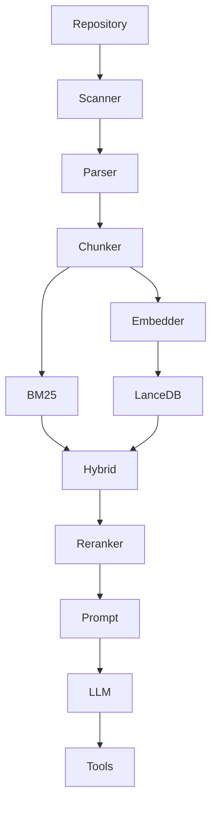

# Architecture

Mini Code Agent is a layered local RAG coding assistant. Each layer has a narrow interface so you can swap parsers, embedders, vector stores, rerankers, or LLM providers without rewriting the CLI.

## Query path

1. **Planner** — routes direct answer, retrieval-only, or tool-enabled paths.
2. **LangGraph** — checkpoints analyze/retrieve/model/tool steps and routes repeated model/tool cycles.
3. **Hybrid retrieval** — BM25 + semantic fusion, optional **ScoreFusionReranker**.
4. **Prompt builder** — bounded repository context and conversation history.
5. **Agent executor** — single model and tool steps (tools gated by plan and CLI flags).

## Indexing path

Scan → parse (Tree-sitter) → AST chunk → embed batch → LanceDB upsert, with a hash manifest for incremental updates.

## Replaceability

| Layer | Default | Alternatives |
| --- | --- | --- |
| Parser | Tree-sitter | Any `SourceParser` |
| Embedder | Sentence Transformers | `MockEmbedder`, custom |
| Vector store | LanceDB | New `VectorStore` impl |
| Retrieval | Hybrid + reranker | Semantic-only, BM25-only |
| LLM | Groq | OpenAI-compatible client |
| Orchestration | LangGraph routing | Custom state machine |

See sibling docs under `docs/` for subsystem detail.
